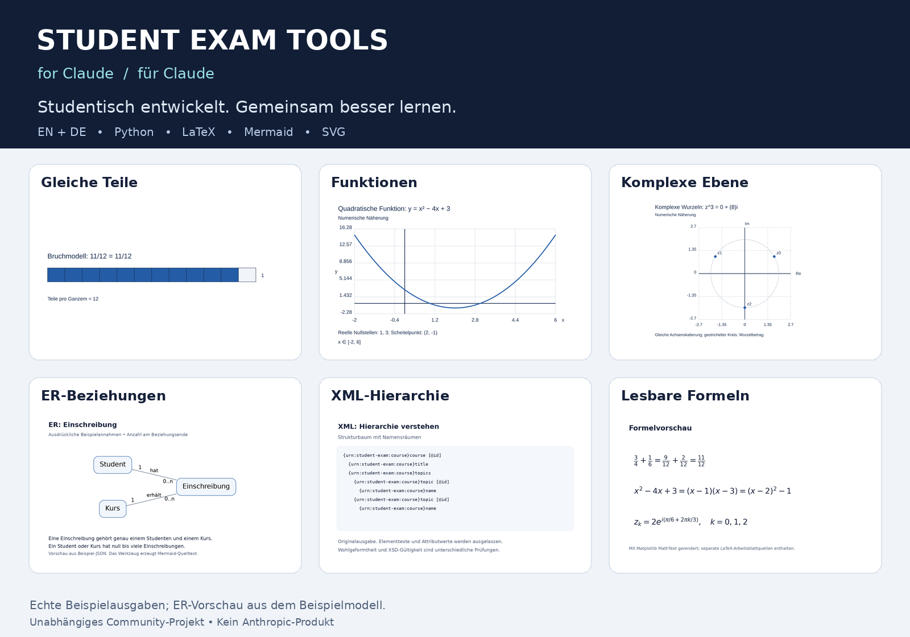
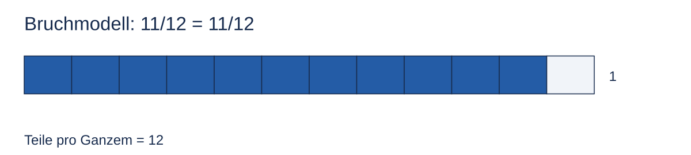
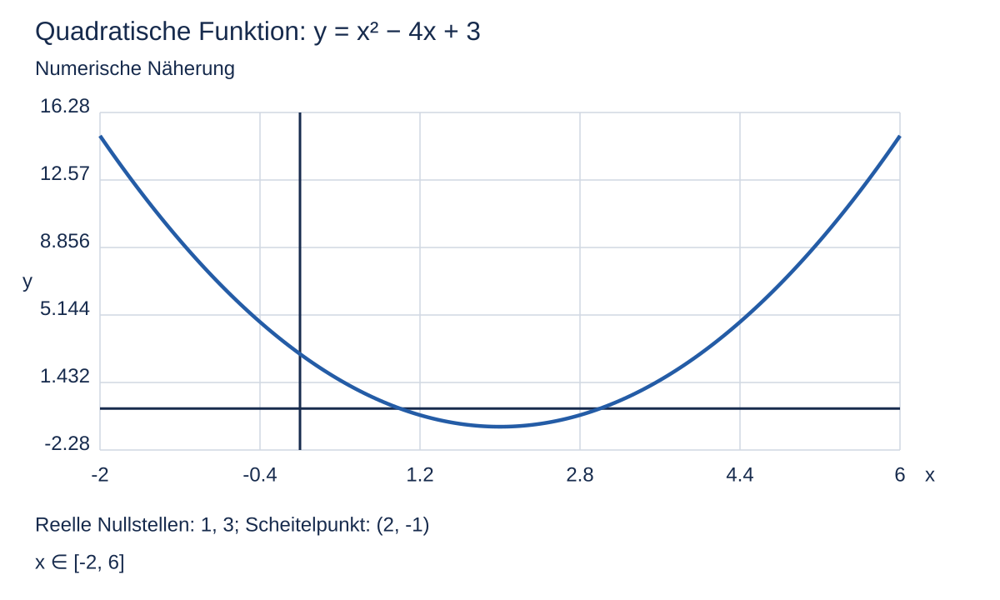
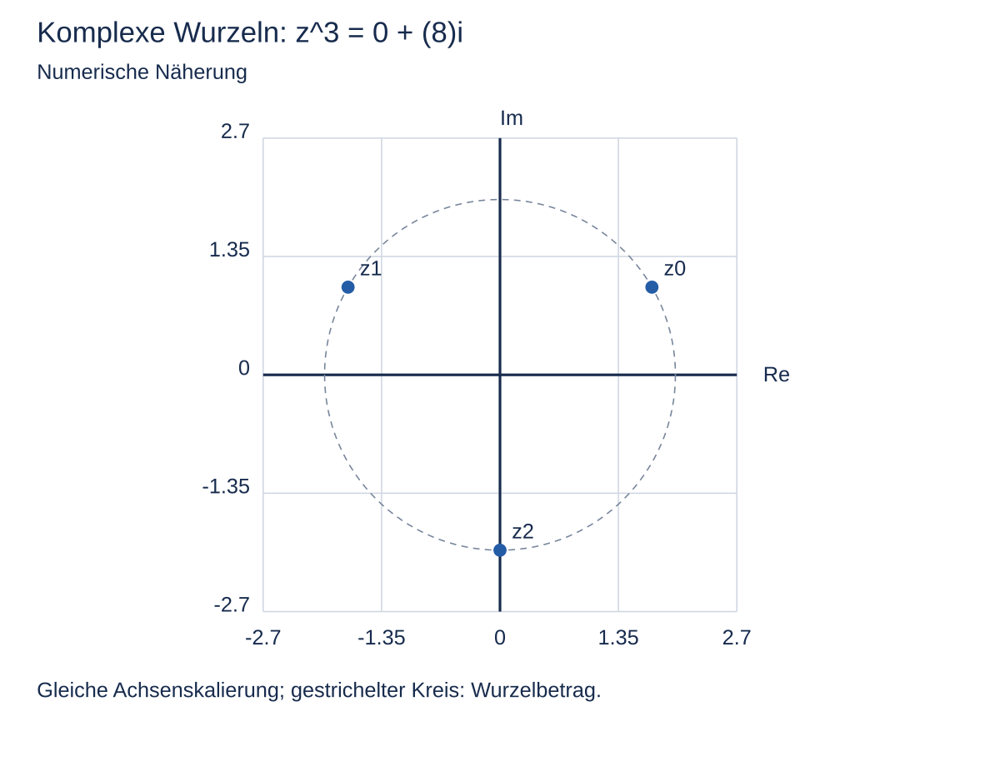
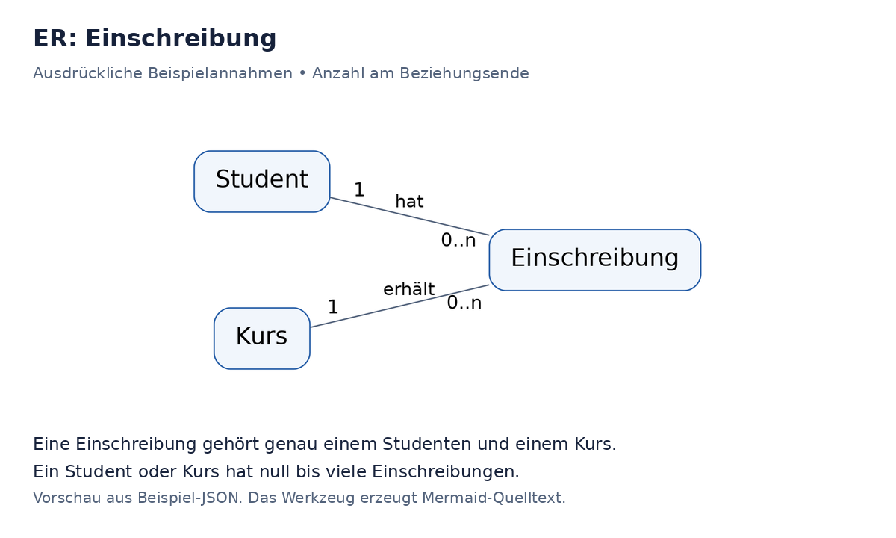
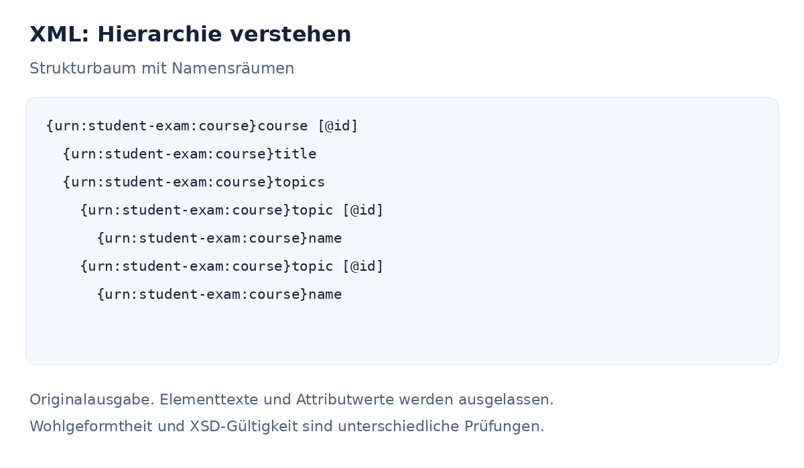
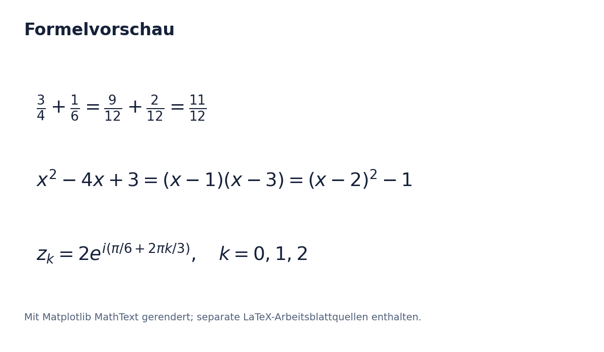
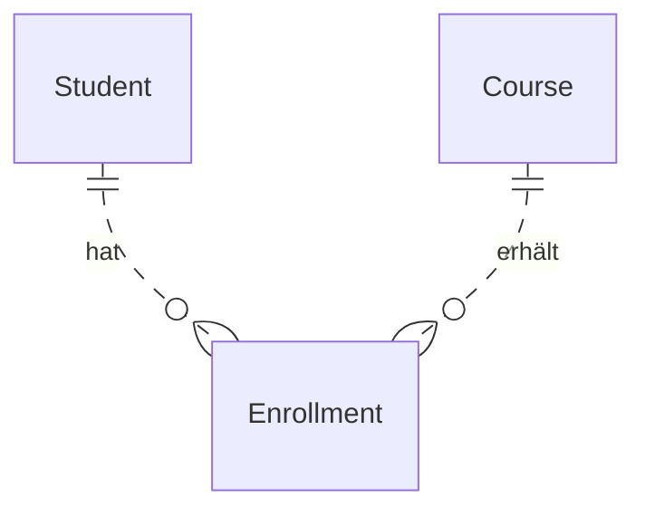

# Student Exam Tools for Claude

**Studentisch entwickelt. Gemeinsam besser lernen.**



Visuelle Prüfungsvorbereitung mit deutschen und englischen Claude-Skills: Konzepte verstehen, selbst einen Schritt versuchen, Darstellungen prüfen und die eigene Lösung kontrollieren.

[English](README.md) · [Installation](docs/installation-de.md) · [Beispiele](docs/examples-de.md) · [Qualität und Grenzen](docs/quality-de.md) · [Mitmachen](CONTRIBUTING.de.md)

**Stand: v0.1.0, frühe Entwicklungsphase.** Enthalten sind installierbare Skill-Ordner und lokale Python-Helfer. Dies ist ein unabhängiges Community-Projekt, kein Anthropic-Produkt und kein bestätigter Lehrplan. Die Umsetzung entstand mit KI-Unterstützung; Lernwirksamkeit und Verhalten in einem echten Claude-Konto wurden bisher nicht gemessen.

## Projektfakten

Zwei installierbare Sprach-Skills · Fünf lokale Helfer · 54 automatische Testmethoden in CI unter Python 3.10, 3.12 und 3.13 bestanden · 20 zweisprachige Verhaltensfälle definiert. Dies ist eine frühe öffentliche Version; der vollständige Live-Claude-Vergleich und externe Nutzung sind bislang nicht dokumentiert.

[Nachweise und nächste Meilensteine](PROJECT.de.md) · [Maschinenlesbare Fakten](project.json)

## Funktionen

| Bereich | Lernablauf | Enthaltenes ausführbares Werkzeug |
| --- | --- | --- |
| Brüche, Klasse 5–6 | gleiche Teile, Hinweise, unabhängige Proben | zugängliche SVG-Balken, auch für unechte Brüche |
| Schulmathematik | Gleichungen, Prozentrechnung, Funktionen, Geometrie | Parabelgraphen als SVG, numerische Nullstellen und Scheitel |
| Oberstufe / Uni-Einstieg | Analysis, Vektoren, komplexe Zahlen, Matrizen, Beweise | Wurzelgrafiken der komplexen Ebene, Lernregeln und geprüfte Beispiele; kein allgemeiner symbolischer Solver |
| ER-Modellierung | Entitäten, Beziehungen, Min–Max und Notationswechsel | geprüftes JSON zu binären, nicht identifizierenden Mermaid-Beziehungen |
| XML | Hierarchie, Attribute und Namensräume | begrenzter UTF-8-Strukturbaum ohne DTDs oder Entity-Deklarationen |
| Prüfungstraining | Hinweis-, Kontroll-, Erklär- und Probeklausurmodus | getrennte LaTeX-Arbeitsblattquellen auf Deutsch und Englisch |

Die Themenstufen steuern Erklärungen. Sie bedeuten keine vollständig getestete Abdeckung aller Themen oder regionalen Lehrpläne. Beginne mit den [durchgerechneten Beispielen](docs/examples-de.md).

## Visuelle Beispiele

Die Vorschaubilder zeigen die beiliegenden Beispiele. Öffne ein Bild für eine größere Ansicht. ER verwendet dasselbe Beispielmodell; Formeln werden mit MathText dargestellt, unabhängig von den `.tex`-Arbeitsblättern.

| Brüche: gleich große Teile | Funktionen: Nullstellen und Scheitel |
| --- | --- |
|  |  |

| Komplexe Ebene: drei Kubikwurzeln von 8i | ER: ausdrückliche Beziehungen und Anzahlen |
| --- | --- |
|  |  |

| XML: Hierarchie mit Namensräumen | Formeln: lesbare mathematische Notation |
| --- | --- |
|  |  |

Siehe die [durchgerechneten Beispiele](docs/examples-de.md), [Bildbeschreibungen und Neuerzeugung](docs/visuals-de.md) sowie die [englischen Vorschaubilder](README.md).

## Schnellstart

Wähle für Claude **ein Sprachpaket**, damit nicht zwei Skills automatisch auf denselben Auftrag reagieren. Beide können auf Wunsch in einer anderen Sprache antworten. Das Projekt benötigt keinen API-Schlüssel; die aktuelle Funktionsverfügbarkeit deines Claude-Kontos und Organisationsregeln gelten weiterhin.

Fertige Pakete: [Deutsches Skill-ZIP](packages/student-exam-de.zip) · [Englisches Skill-ZIP](packages/student-exam-en.zip) · [SHA-256-Prüfsummen](packages/SHA256SUMS.json). Öffne auf GitHub das ZIP und wähle **Download raw**. Zum lokalen Neuerzeugen:

Erzeuge die beiden Upload-ZIPs im Hauptordner des Repositories:

```bash
python3 scripts/build_skills.py
```

Lade `dist/student-exam-de.zip` **oder** `dist/student-exam-en.zip` im Bereich für eigene Claude-Skills hoch. Die [vollständige Installationsanleitung](docs/installation-de.md) erklärt Claude Code, Windows und Fehlerbehebung.

Beispielaufträge:

> Nutze Student Exam. Gib mir nur den nächsten Hinweis zu 3/4 + 1/6 auf dem Niveau der 5. Klasse.

> Prüfe mein ER-Modell. Erkläre jede Kardinalität in beiden Richtungen und kennzeichne Annahmen.

> Erkläre alle Lösungen von z³ = 8i mit exakten LaTeX-Formeln und einer unabhängigen Probe.

## Werkzeuge ohne Claude verwenden

Python 3.10+; keine Laufzeit-Zusatzpakete, Netzwerkaufrufe oder Telemetrie. Befehle im Hauptordner ausführen:

```bash
python3 src/student_exam_tools/toolkit.py fraction 11 12 --lang de --output bruch.svg
python3 src/student_exam_tools/toolkit.py quadratic 1 -4 3 --lang de --output parabel.svg
python3 src/student_exam_tools/toolkit.py complex-roots 0 8 3 --lang de --output complex.svg
python3 src/student_exam_tools/toolkit.py er examples/enrollment.json
python3 src/student_exam_tools/toolkit.py xml examples/course.xml --lang de
```

`--output` überschreibt keine vorhandene Datei. Optional lokal installieren: `python3 -m pip install .`, danach `student-exam --help`. Die Helfer funktionieren ohne Installation; Paketbau kann zusätzliche Build-Werkzeuge benötigen.

## Kleines ER-Beispiel

Ein Student hat null bis viele Einschreibungen; jede Einschreibung gehört genau einem Studenten. Ein Kurs hat null bis viele Einschreibungen; jede Einschreibung gehört genau einem Kurs. Dies sind ausdrücklich gesetzte Beispielannahmen.



Die Zeichen neben Enrollment zählen Einschreibungen je einem Studenten/Kurs. Die gepunktete Linie bezeichnet eine nicht identifizierende Beziehung; die optionale Teilnahme wird durch die Endzeichen ausgedrückt.

## Entwickeln und prüfen

```bash
python3 -m unittest discover -s tests -v
python3 scripts/build_skills.py --check
python3 scripts/validate_repo.py
```

Die Tests prüfen Ausgangsgleichungen, alle 16 unterstützten Endpunktkombinationen, schädliche/fehlerhafte Eingaben, eigenständige Ausführung und Überschreibschutz. Siehe [Evaluationsfälle](evals/cases.json), [drei Prüfdurchgänge](docs/quality-de.md), [Quellenbegründung](docs/sources-de.md) und [Entwicklungsplan](docs/community-de.md).

Automatische Tests kontrollieren deterministischen Code und bekannte Beispiele. Sie sind kein gemessener Claude-Benchmark. Teste den Skill mit eigenen Aufgaben und trage anonymisierte Ergebnisse samt Modell/Version und tatsächlicher Ausgabe bei. Lade keine privaten Schulunterlagen hoch und erfinde keine Nutzungszahlen.

## Lizenz und Mitwirkung

MIT gilt für eigene Programme, Anleitungen, Dokumentation und Beispiele; fremde Quellen werden verlinkt statt kopiert. Beiträge sind in beiden Sprachen willkommen. Siehe [Mitwirkung](CONTRIBUTING.de.md), [Verhaltensregeln](CODE_OF_CONDUCT.md) und [Sicherheit](SECURITY.md).
