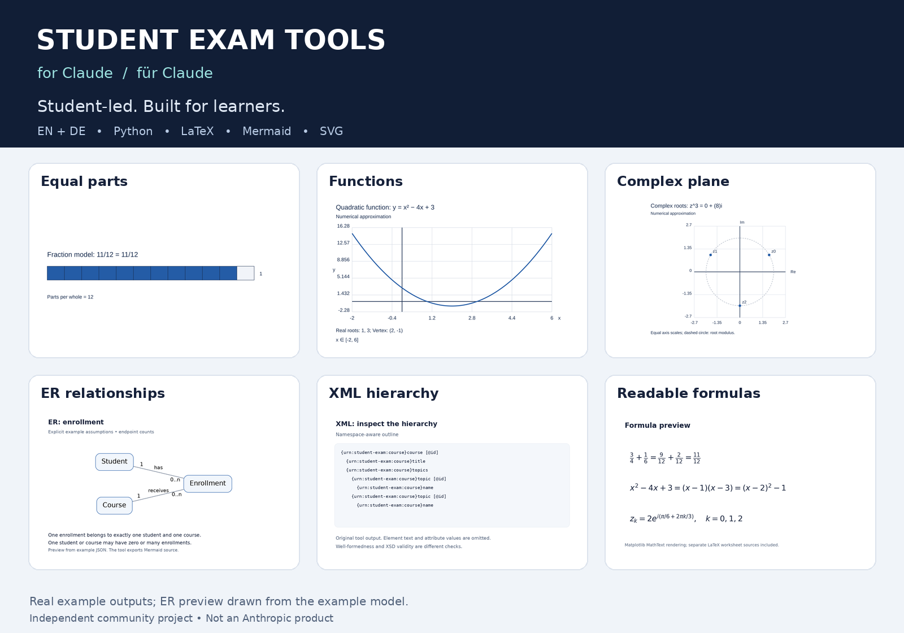
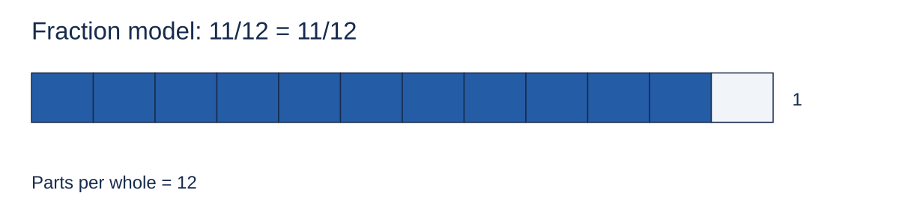
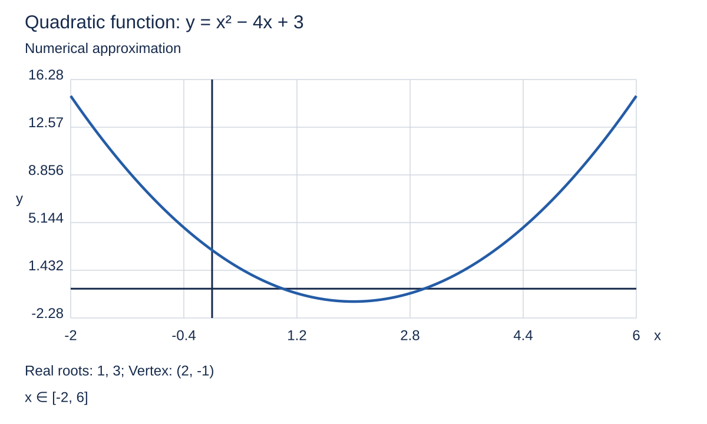
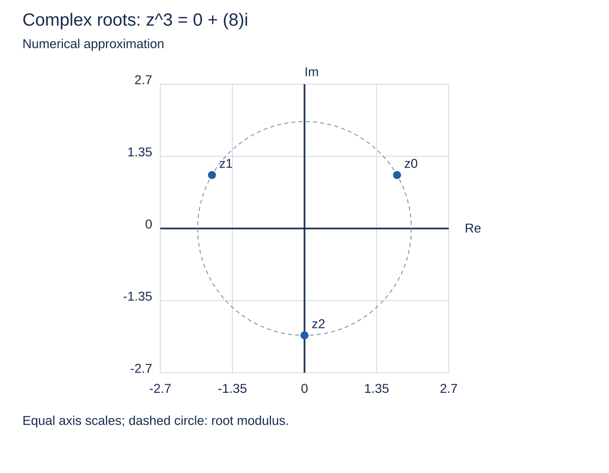
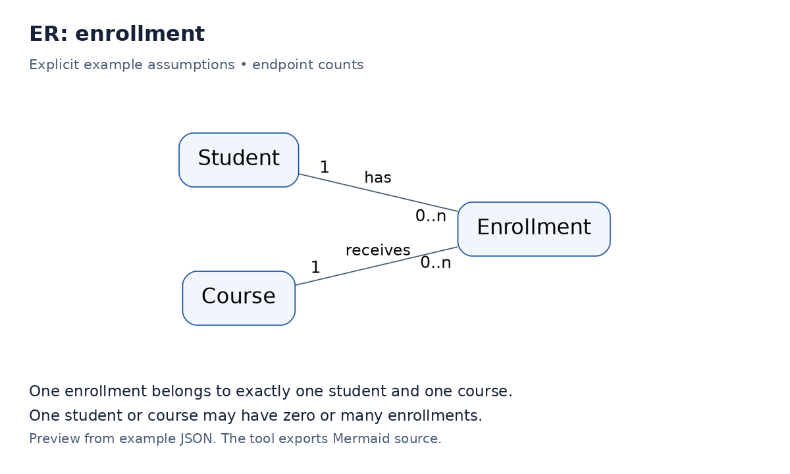
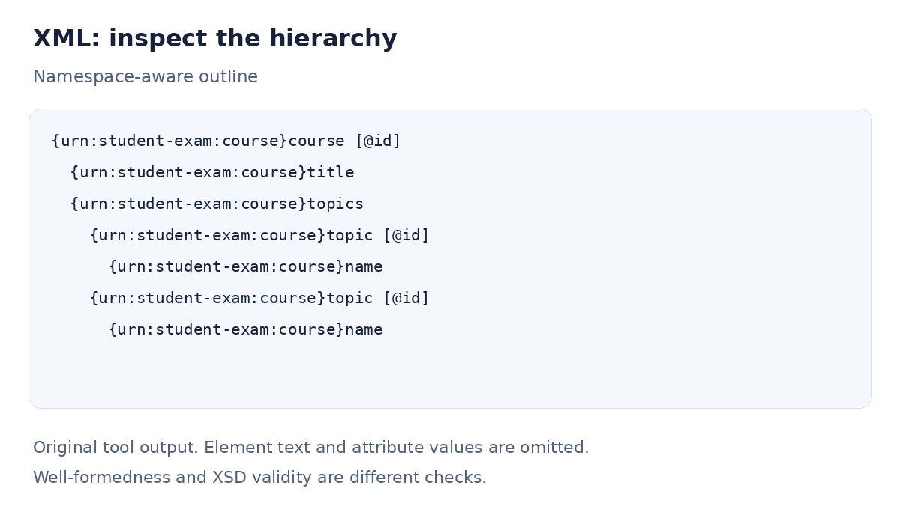
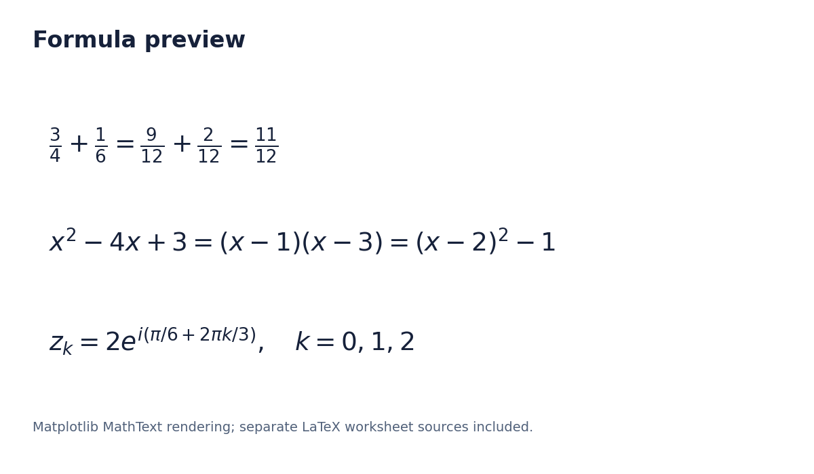
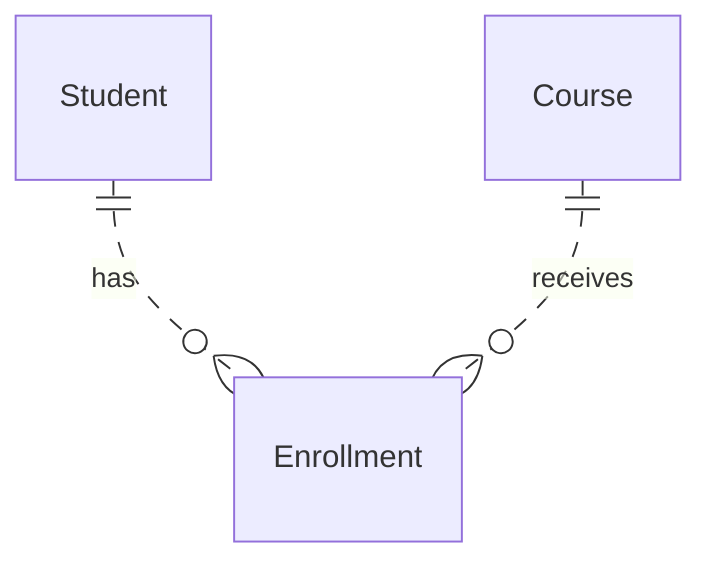

# Student Exam Tools for Claude

**Student-led. Built for learners.**



Visual exam preparation with English and German Claude skills: understand a concept, try a step, inspect a diagram, and check the reasoning.

[Deutsch](README.de.md) · [Installation](docs/installation-en.md) · [Examples](docs/examples-en.md) · [Quality & limitations](docs/quality-en.md) · [Contributing](CONTRIBUTING.md)

**Status: v0.1.0, early-stage.** The repository contains installable skill folders and offline Python helpers. It is an independent community project, not an Anthropic product or an endorsed curriculum. AI-assisted implementation is disclosed; learning effectiveness and behavior in a live Claude account have not yet been measured.

## Project facts

Two installable language skills · Five offline helpers · 54 automated test methods passing in CI on Python 3.10, 3.12 and 3.13 · 20 bilingual behavioral cases defined. This is an early public release; the full live-Claude comparison and downstream adoption are not yet documented.

[Evidence and next milestones](PROJECT.md) · [Machine-readable facts](project.json)

## What it does

| Area | Learning workflow | Included executable helper |
| --- | --- | --- |
| Fractions, grades 5–6 | equal parts, hints, independent checks | accessible SVG bars, including improper fractions |
| Secondary mathematics | equations, percentages, functions, geometry | quadratic SVG graphs and numerical root/vertex analysis |
| Upper secondary / introductory university | calculus, vectors, complex numbers, matrices, proofs | complex-plane root SVGs, reasoning guidance and checked fixtures; no general symbolic solver |
| ER modeling | entities, relationships, min–max, notation translation | validated JSON to binary non-identifying Mermaid relationships |
| XML | hierarchy, attributes, namespaces | bounded UTF-8 XML outline, without DTDs or entity declarations |
| Study practice | hint, check, explanation and practice-exam modes | separate LaTeX worksheet sources in EN/DE |

The topic bands guide explanations. They do not mean every topic or regional curriculum has a tested lesson. Start with the [worked examples](docs/examples-en.md).

## Visual examples

These previews show the bundled examples. Open an image for a larger view. ER uses the same example model; formulas are rendered with MathText, independently of the `.tex` worksheets.

| Fractions: equal-sized parts | Functions: roots and vertex |
| --- | --- |
|  |  |

| Complex plane: three cube roots of 8i | ER: explicit relationships and endpoint counts |
| --- | --- |
|  |  |

| XML: namespace-aware hierarchy | Mathematical formulas: readable notation |
| --- | --- |
|  |  |

See the [step-by-step examples](docs/examples-en.md), [image descriptions and regeneration](docs/visuals-en.md), and [German previews](README.de.md).

## Quick start

For Claude, choose **one language package** to avoid duplicate automatic triggers. Both can answer in another language when asked. No API key is required by this project; your Claude account's current feature availability and organization policy still apply.

Ready-made packages: [English skill ZIP](packages/student-exam-en.zip) · [German skill ZIP](packages/student-exam-de.zip) · [SHA-256 checksums](packages/SHA256SUMS.json). On GitHub, open the ZIP and choose **Download raw**. To rebuild locally:

Build the two upload ZIPs from the repository root:

```bash
python3 scripts/build_skills.py
```

Upload `dist/student-exam-en.zip` **or** `dist/student-exam-de.zip` to Claude's custom Skills area. See the [complete installation guide](docs/installation-en.md) for Claude Code, Windows and troubleshooting.

Try:

> Use Student Exam. Give me only the next hint for 3/4 + 1/6, at grade 5 level.

> Check my ER model. For each relationship, explain the multiplicity in both directions and identify assumptions.

> Explain all solutions of z³ = 8i with exact LaTeX and an independent check.

## Run the tools without Claude

Python 3.10+; no runtime dependencies, network calls or telemetry. Run from the repository root:

```bash
python3 src/student_exam_tools/toolkit.py fraction 11 12 --output fraction.svg
python3 src/student_exam_tools/toolkit.py quadratic 1 -4 3 --output parabola.svg
python3 src/student_exam_tools/toolkit.py complex-roots 0 8 3 --lang en --output complex.svg
python3 src/student_exam_tools/toolkit.py er examples/enrollment.json
python3 src/student_exam_tools/toolkit.py xml examples/course.xml
```

Use `--lang de` for German visual labels. `--output` refuses to overwrite an existing file. Optional local package installation: `python3 -m pip install .`, then `student-exam --help`. The helpers do not need installation; packaging may require build tooling.

## A small ER example

One student may have no enrollments or many; each enrollment belongs to exactly one student. One course may receive no enrollments or many; each enrollment belongs to exactly one course. These are explicit example assumptions.



Read the symbol next to Enrollment as the number of enrollments for one student/course. The dotted line marks a non-identifying relationship; optionality is carried by the endpoint symbol.

## Develop and verify

```bash
python3 -m unittest discover -s tests -v
python3 scripts/build_skills.py --check
python3 scripts/validate_repo.py
```

The suite includes original-equation checks, all 16 supported endpoint combinations, malicious/malformed inputs, standalone execution and overwrite protection. See [evaluation cases](evals/cases.json), [the three review passes](docs/quality-en.md), [source rationale](docs/sources-en.md), and [roadmap](docs/community-en.md).

The automated tests check deterministic code and known fixtures. They are not a measured Claude benchmark. Help test the skill on your own tasks and contribute anonymized results with the model/version and observed output. Do not submit private school material or fabricated usage figures.

## License and participation

MIT for original code, instructions, documentation and examples; external source material is linked rather than copied. Contributions in either language are welcome. See [contribution guidance](CONTRIBUTING.md), [conduct](CODE_OF_CONDUCT.md) and [security guidance](SECURITY.md).
