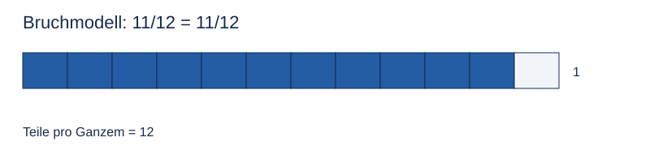
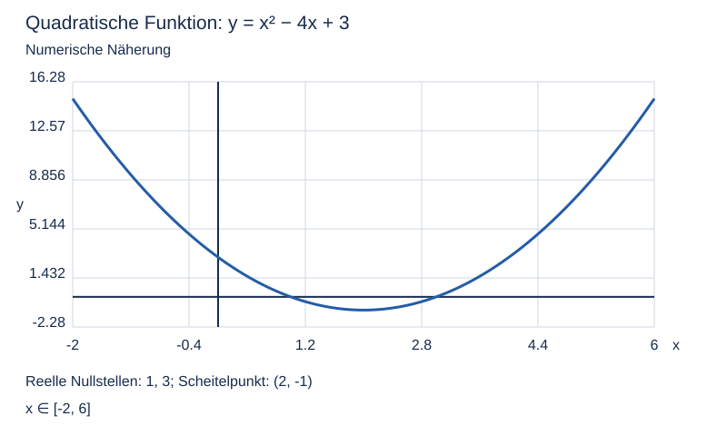
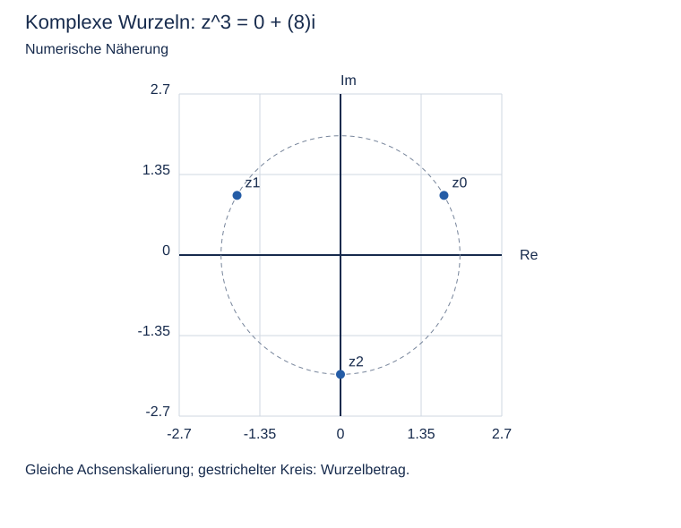
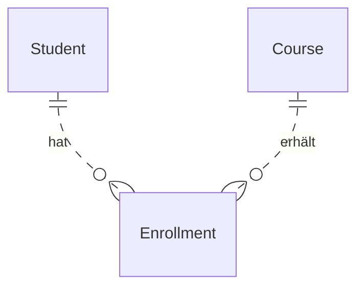

# Durchgerechnete Beispiele — Deutsch

[English](examples-en.md) · [Start](../README.de.md)

Alle Aufgaben hier sind eigene Beispiele. Halte diese Lösungen im Probeklausurmodus vom Aufgabenblatt getrennt.

## 1. Klasse 5–6: gleiche Teile

**Aufgabe:** Addiere 3/4 und 1/6. **Erster Hinweis:** Suche gleich große Teilstücke desselben Ganzen. Ein guter Hinweis verrät weder Nenner noch Ergebnis.

**Lösung auf Nachfrage:** $3/4+1/6=9/12+2/12=11/12$. Prüfe $11/12<1$ und vergleiche Dezimalwerte nur als zweite Kontrolle. Der Balken zeigt den Ergebnisbruch; er erklärt allein noch nicht den gemeinsamen Nenner.

## 2. Schule: quadratische Funktion

Für $f(x)=x^2-4x+3=(x-1)(x-3)=(x-2)^2-1$ liegen die Nullstellen bei 1 und 3 und der Scheitel bei (2,−1). Einsetzen ergibt f(1)=f(3)=0. Der positive Leitkoeffizient bedeutet eine Öffnung nach oben. Beachte Achsenskalen; beurteile Steilheit nicht anhand einer verzerrten Zeichnung.

## 3. Uni-Einstieg: komplexe Wurzeln

Schreibe für $z^3=8i$ zunächst $8i=8e^{i(\pi/2+2\pi k)}$. Dann gilt

$$z_k=2e^{i(\pi/6+2\pi k/3)},\quad k=0,1,2.$$

Also $z_0=\sqrt3+i$, $z_1=-\sqrt3+i$, $z_2=-2i$. Kubieren ergibt für jeden Kandidaten 8i; weitere k wiederholen eine Wurzel. Die Winkelabstände betragen $2\pi/3$, nicht $2\pi$.

## 4. Uni-Einstieg: Matrixwirkung

Für $A=\begin{pmatrix}2&1\\1&2\end{pmatrix}$ ergibt Multiplikation $A(1,1)^T=3(1,1)^T$ und $A(1,-1)^T=(1,-1)^T$. Die unabhängigen Richtungen bilden eine Eigenbasis. Erkläre, wie ein an diesen Richtungen ausgerichtetes Quadrat gestreckt wird; behaupte keine gleich starke Streckung in jeder Richtung.

## 5. ER: Einschreibung

Nutze [enrollment.json](../examples/enrollment.json). Jede Einschreibung gehört genau einem Studenten und einem Kurs; ein Student oder Kurs kann null bis viele Einschreibungen haben. Dies sind Beispielvorgaben, keine Schlussfolgerungen aus den Substantiven.

Der Helfer definiert bewusst weder Schlüssel noch Attribute, die Eindeutigkeit von (Student,Kurs) oder identifizierende Beziehungen. Ergänze diese Anforderungen separat. „Mindestens zwei Stücke je CD“ benötigt (2,n) als Text/Min–Max-Notation und eine ausdrückliche Vorgabe für die Gegenrichtung.

## 6. XML: Hierarchie mit Namensräumen

Wende den Helfer auf [course.xml](../examples/course.xml) an. Der Namensraum lautet `urn:student-exam:course`; alle unpräfixierten Elementnamen erben ihn. Die `id`-Attribute erben ihn nicht. Siehe [erzeugter Strukturbaum](../examples/xml-de.md). Texte und Attributwerte fehlen bewusst; die Übersicht ist weder eine verlustfreie XML-Serialisierung noch ein Nachweis der XSD-Gültigkeit.

## Arbeitsblätter

Die [deutsche LaTeX-Quelle](../examples/worksheet-de.tex) und [englische LaTeX-Quelle](../examples/worksheet-en.tex) enthalten Aufgaben ohne Lösungen. Kompiliere lokal mit einem vertrauenswürdigen TeX-System; Shell-Escape wird nicht benötigt.
