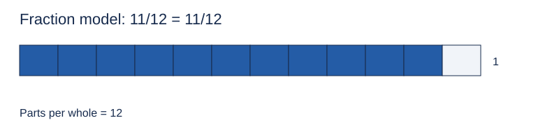
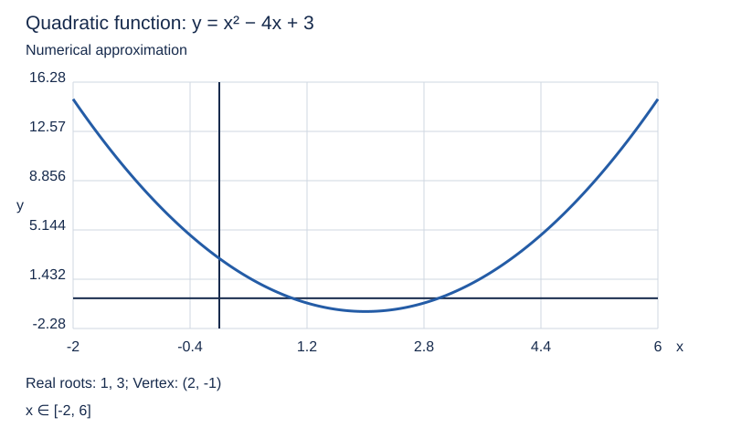
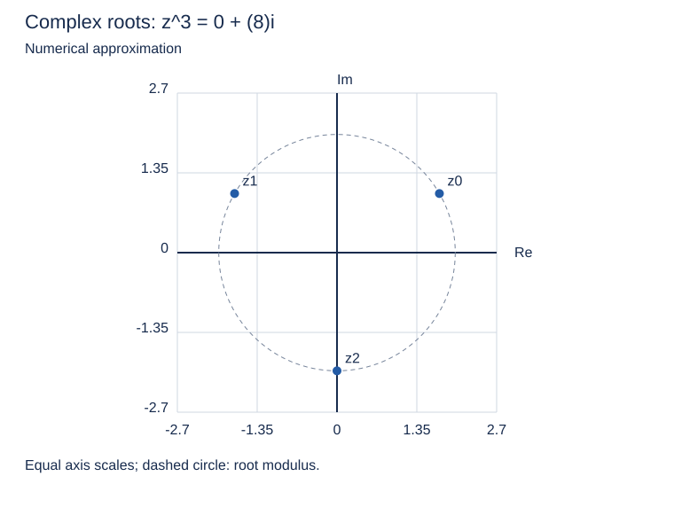
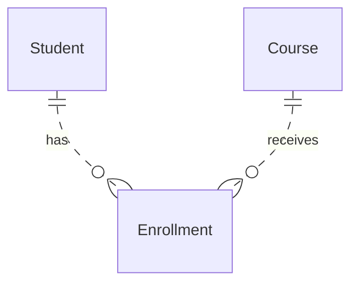

# Worked examples — English

[Deutsch](examples-de.md) · [Home](../README.md)

All tasks here are original fixtures. In practice-exam mode keep these solutions separate from the question sheet.

## 1. Grade 5–6: equal parts

**Task:** Add 3/4 and 1/6. **First hint:** find equal-sized pieces for the same whole. A good hint does not reveal the denominator or result.

**Solution on request:** $3/4+1/6=9/12+2/12=11/12$. Check $11/12<1$ and compare decimal values only as a second check. The bar shows the final fraction; it does not explain the common denominator by itself.

## 2. Secondary: quadratic function

For $f(x)=x^2-4x+3=(x-1)(x-3)=(x-2)^2-1$, roots are 1 and 3; vertex is (2,−1). Substitution gives f(1)=f(3)=0. Positive leading coefficient means opening upward. Scales on the axes matter; do not judge steepness from a stretched drawing.

## 3. Introductory university: complex roots

For $z^3=8i$, write $8i=8e^{i(\pi/2+2\pi k)}$. Then

$$z_k=2e^{i(\pi/6+2\pi k/3)},\quad k=0,1,2.$$

Thus $z_0=\sqrt3+i$, $z_1=-\sqrt3+i$, $z_2=-2i$. Cubing yields 8i for each candidate; changing k beyond these three repeats a root. The unit angles differ by $2\pi/3$, not by $2\pi$.

## 4. Introductory university: matrix action

For $A=\begin{pmatrix}2&1\\1&2\end{pmatrix}$, multiplication gives $A(1,1)^T=3(1,1)^T$ and $A(1,-1)^T=(1,-1)^T$. These independent directions form an eigenbasis. Explain how a square aligned with those directions stretches; do not claim the map scales every direction by the same factor.

## 5. ER: enrollment

Use [enrollment.json](../examples/enrollment.json). Each enrollment belongs to one student and one course; a student or course may have zero or many enrollments. These conditions are stipulated in the example, not inferred from the nouns.

The helper deliberately does not define keys, attributes, uniqueness of (student,course), or identifying relationships. Supply these requirements separately. “At least two tracks per CD” requires (2,n) text/min–max notation and an explicit reverse-direction requirement.

## 6. XML: hierarchy with namespaces

Run the helper on [course.xml](../examples/course.xml). The namespace is `urn:student-exam:course`; all its unprefixed element names inherit it. The `id` attributes do not inherit that namespace. See [generated outline](../examples/xml-en.md). Text and attribute values are intentionally omitted; the outline is not a lossless XML serialization or proof of XSD validity.

## Worksheets

[English LaTeX source](../examples/worksheet-en.tex) and [German LaTeX source](../examples/worksheet-de.tex) contain questions without solutions. Compile locally with a trusted TeX installation; no shell escape is needed.
